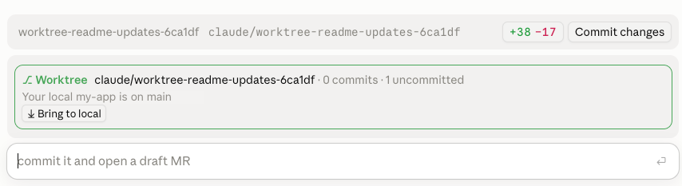
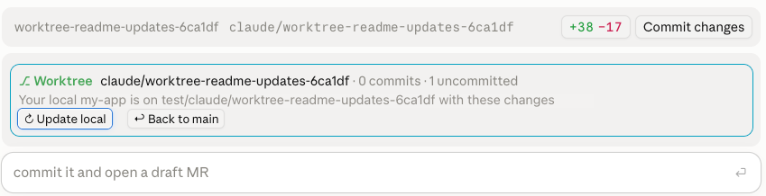

# worktree-sync

A Claude Code mod for sessions that work in a git worktree. A band above the prompt shows the worktree's branch, how many commits it has, and how many files are uncommitted, with two buttons:

- **⤓ Bring to local**: switches your main checkout to a `test/<worktree-branch>` branch at the worktree's latest commit and copies the worktree's uncommitted changes there, staged. Press it again (**↻ Update local**) after more work to refresh.
- **↩ Back to `<branch>`**: drops the copied changes, returns your main checkout to the branch it was on before the first sync, and deletes the `test/…` branch.

Before a sync:



After a sync, your local checkout is on the test branch:



The band is hidden when the session isn't in a worktree, and stays hidden until the worktree has commits or uncommitted changes. If your main checkout is still on the worktree's `test/…` branch, the band stays visible so you can always go back. `/sync-to-local` and `/restore-local` do the same as the buttons.

## Safety

- The worktree itself is never modified.
- If your main checkout has uncommitted changes of your own, nothing happens until you commit, stash or discard them.
- If you commit on the `test/…` branch, a sync won't overwrite those commits, and going back keeps the branch.
- Git hooks don't run while it switches branches.

## Install

In a Claude Code terminal session:

```
/plugin install worktree-sync --marketplace jean-moulinette/worktree-sync
```

Answer `y` to add the marketplace, then pick the user scope. It then loads in every session, including the desktop app's Code tab.

## Develop

```
claude plugin validate .
claude plugin test .
```
